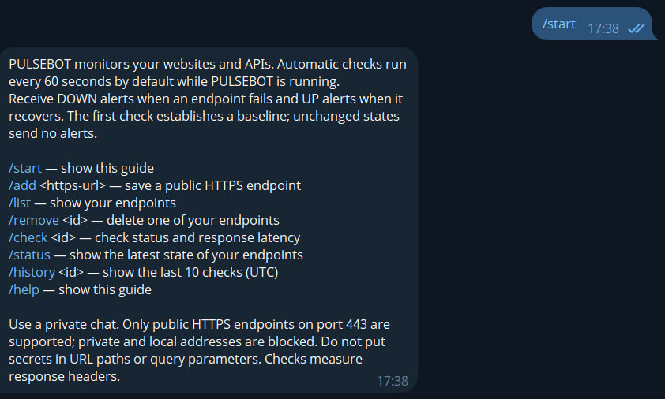
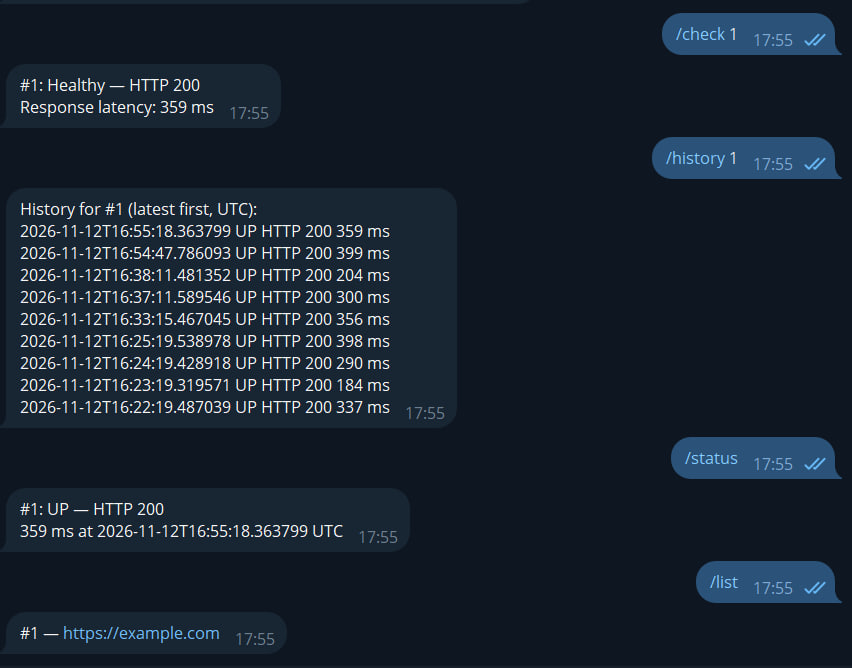

# PULSEBOT

A Python Telegram bot that checks public HTTPS websites and API endpoints, records
their health in SQLite, and notifies their owners when availability changes.

This backend portfolio project demonstrates asynchronous I/O, modular design,
transactional persistence, defensive HTTP handling, and offline testing.
**PULSEBOT runs locally and is not currently deployed for 24/7 monitoring.** Checks
and alerts require the process to remain running with an Internet connection.

## Screenshots



*Telegram commands and endpoint status in a private bot chat.*



*Recorded monitoring results and website health checks.*

## Key features

- Scheduled and manual HTTPS checks with HTTP status, response latency, and UTC timestamps.
- DOWN and recovery (UP) alerts on state changes, with persisted duplicate suppression.
- Telegram user ownership for endpoint management, status, and history.
- Bounded concurrency, per-endpoint overlap prevention, local process locking,
  and graceful shutdown.
- URL, DNS, and socket-level SSRF controls with verified TLS connections.

## Tech stack and architecture

Python **3.12+**, aiogram **3**, aiohttp, SQLAlchemy **2** async with aiosqlite,
Pydantic Settings, and certifi. Development tools: pytest, pytest-asyncio, and Ruff.
Dependencies and tool settings are defined in [pyproject.toml](pyproject.toml).

| Module | Responsibility |
| --- | --- |
| `app/__main__.py` | Startup, dependency injection, Telegram long polling, and cleanup |
| `app/config.py` | Validated environment configuration and secret token type |
| `app/handlers.py` | Commands, private-chat checks, and user-facing responses |
| `app/monitor.py` | Shared manual/scheduled check coordination and incident delivery |
| `app/checker.py` | Async HTTPS requests, redirects, timeouts, and latency |
| `app/security.py` | URL policy, validating DNS resolver, and socket factory |
| `app/db.py` | SQLite models, owner-scoped queries, history, and incident outbox |
| `app/instance.py` | OS file lock for one monitoring process per local database |

Handlers and the scheduler share a monitoring service. Results go through the
repository; a separate async task delivers persisted incident events to Telegram.
SQLite stores endpoints, checks, and incidents. Startup creates missing tables,
including Phase 2 tables for an existing Phase 1 database without replacing endpoints.

## Run locally on Windows

Install Python 3.12 or newer. From the project root in PowerShell:

```powershell
py -3.12 -m venv .venv
.\.venv\Scripts\python.exe -m pip install -e ".[dev]"
```

If the Python launcher cannot find your installation, replace the first command
with its executable path, for example:

```powershell
& "$env:LOCALAPPDATA\Programs\Python\Python312\python.exe" -m venv .venv
```

Copy the configuration template without overwriting an existing `.env`:

```powershell
if (-not (Test-Path .env)) { Copy-Item .env.example .env }
notepad .env
```

Create a bot through Telegram's **@BotFather** and set `BOT_TOKEN` in your local
`.env`. Keep the token private; never include it in screenshots, commands, or shared
logs. Environment variables override `.env` values. Shell activation is not required.

```powershell
.\.venv\Scripts\python.exe -m app
```

Open a private chat with your bot and send `/start`. Stop with **Ctrl+C**; shutdown
cancels and awaits active monitoring work before closing resources. Run one process
per bot and local database. A second Phase 2 process using the same resolved database
path is rejected by an OS lock.

### Configuration

| Variable | Default | Purpose |
| --- | --- | --- |
| `BOT_TOKEN` | Required | Telegram bot credential |
| `DATABASE_URL` | `sqlite+aiosqlite:///./pulsebot.db` | SQLite file, relative to the working directory |
| `MONITOR_INTERVAL_SECONDS` | `60` | Target cycle interval (1–86400 seconds) |
| `HTTP_TIMEOUT_SECONDS` | `10` | Total check deadline including redirects (greater than 0, up to 60 seconds) |
| `MAX_CONCURRENT_CHECKS` | `10` | Shared active-check limit (1–100) |
| `MAX_REDIRECTS` | `3` | Maximum redirect hops (0–10) |

## Telegram commands

Use commands in a private chat. Replace `1` with an endpoint ID returned by `/add`.

| Command | Behavior |
| --- | --- |
| `/start`, `/help` | Show commands, monitoring behavior, and security guidance |
| `/add https://example.com` | Save a public HTTPS endpoint for monitoring |
| `/list` | List your saved endpoint IDs and URLs |
| `/check 1` | Run and save a manual check; report HTTP status and latency |
| `/status` | Show each endpoint's latest recorded state, or UNKNOWN before its first check |
| `/history 1` | Show the latest 10 checks, newest first, with UTC timestamps |
| `/remove 1` | Delete your endpoint, its check history, and incident records |

## Monitoring and alert semantics

The first cycle starts immediately. Subsequent cycles target **60 seconds** between
starts by default. Slow cycles finish before another starts; missed ticks are not
replayed. Endpoints are processed in bounded batches. Manual and scheduled checks
share concurrency controls: a manual request reports an already-running check,
and the scheduler skips a busy endpoint.

A successful check with final HTTP **200–399** is UP. HTTP 4xx/5xx, connection errors,
timeouts, TLS failures, and blocked destinations are DOWN. Latency uses a monotonic
clock through final response headers, including DNS, TLS, and redirects; waiting
for a concurrency slot is excluded. Response bodies are not evaluated.

The first result establishes a baseline and sends no alert, even when DOWN.
**UP → DOWN** creates a DOWN alert; **DOWN → UP** creates a recovery alert labeled UP.
Unchanged states create no notification. Manual and scheduled results update the
same persisted state, status, latency, safe error text, and UTC timestamps.

Results and transition events commit together in a serialized SQLite transaction.
An outbox worker claims each event before sending it to its owner's chat, with a
15-second delivery timeout. Pending events and the baseline survive restarts; sent
events are not replayed. Telegram's explicit rate-limit rejection is retried after
the requested delay; other failed or uncertain deliveries are not retried.

This favors **at-most-once delivery over guaranteed delivery**: a crash or timeout
after claiming an event can lose an alert. Delivery states (`pending`, `attempted`,
`sent`, `uncertain`) remain in the database for inspection.

## HTTP security

- Accept only public HTTPS URLs on port 443; reject URL credentials, control
  characters, backslashes, local names, and non-public IP destinations, including
  private, loopback, link-local, shared, multicast, and reserved addresses.
  IPv6 mapped and transition addresses are also blocked.
- Validate URLs before saving and checking. At connection time, validate **all** DNS
  answers, rejecting mixed public/private results. DNS caching and connection reuse
  are disabled; the socket factory also checks the exact numeric destination before
  socket creation, including literal IP URLs.
- Follow redirects manually with destination validation and a hop limit. Disable
  environment proxies and cookies for endpoint checks.
- Keep TLS certificate and hostname verification enabled. Supplement Python's
  default system trust with certifi's CA bundle, including for Windows installations
  with incomplete local issuer trust.

URLs are stored as plaintext and shown to their owners. Do not include secrets in
paths or query parameters. Protect the database and `.env` with local file permissions.

## Tests and linting

After installing the `dev` extra, run from the project root:

```powershell
.\.venv\Scripts\python.exe -m pytest -q
.\.venv\Scripts\python.exe -m ruff check .
.\.venv\Scripts\python.exe -m ruff format --check .
```

The suite uses mocked HTTP, DNS, and Telegram interactions, temporary SQLite
databases, and a fixture that blocks socket connections and DNS lookups. It requires
no real Telegram token, `.env`, or network access. Tests cover SSRF and TLS controls,
ownership, persistence, scheduler coordination, and incident delivery. An integration
test verifies **200 → 503 → 503 → 200** produces one DOWN and one UP alert, including
restart behavior and persisted history.

## Scope and limitations

- Local operation only: no hosted 24/7 service, deployment configuration, dashboard,
  or AI features. No checks run while the process is stopped or the computer is asleep.
- Public HTTPS GET checks only; no authentication headers, request payloads, body
  assertions, or internal endpoints. Availability reflects one network vantage point,
  not full application correctness.
- Single-host, file-backed SQLite operation. The process lock does not coordinate
  separate database files or distributed workers. No uptime percentages, user quotas,
  general migration framework, or automatic history retention policy.
- Application SSRF controls do not account for unusual routing/NAT that remaps public
  addresses. Production use would also require appropriate network egress controls.
- Dependency ranges are defined in `pyproject.toml`; a reproducible lockfile is not included.
